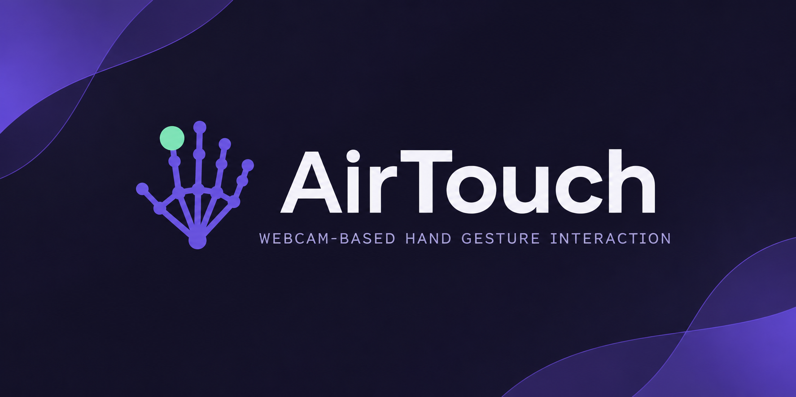

<div align="center">



</div>

# AirTouch

### Fine-Grained Finger Gesture Interaction Using Commodity Camera Sensing

AirTouch is a webcam-based desktop gesture-control application developed as part of a Human-Computer Interaction (HCI) project.

It explores whether a standard laptop webcam can support fine-grained finger-gesture interaction for everyday desktop tasks without requiring specialized wearable hardware.

Using **OpenCV**, **MediaPipe**, and **PyAutoGUI**, AirTouch tracks hand landmarks, recognizes gestures, and translates them into desktop actions such as cursor movement, clicking, scrolling, zooming, and undoing.

The application features a modern desktop interface built with **PySide6**, providing live camera preview and controls to start, pause, resume, and stop gesture interaction.

## Features

- Real-time webcam-based hand tracking.
- Finger landmark detection using MediaPipe.
- Gesture-based desktop cursor control.
- Left-click and right-click interactions.
- Gesture-based scrolling and zooming.
- Undo gesture support.
- Live camera preview.
- Start, Pause, Resume, and Stop controls.
- Built-in "How to use" gesture guide (shown on first launch) and demo video link.
- Per-user calibration and a Settings window, with a one-click switch back to the base settings.
- Gesture status and last recognized action display.
- Smooth camera preview fade-out when stopped.
- Local webcam processing.

## Implemented Gestures

| Gesture | Desktop Action |
|---|---|
| Index finger extended, other fingers closed | Cursor movement |
| Open palm followed by index finger bend | Left click |
| Pinky gesture | Right click |
| Thumb movement to the right | Zoom in |
| Index and middle fingers extended, swipe left | Zoom out |
| Open palm, move hand up | Scroll down (one page) |
| Four fingers open, thumb tucked, move hand down | Scroll up (one page) |
| Thumbs down | Undo |

Gesture detection uses hand landmarks, movement tracking, temporal detection, and confirmation frames where applicable. Scroll and zoom distances are measured in hand sizes, so they behave the same whether you sit close to the camera or far away.

## Technology Stack

| Technology | Purpose |
|---|---|
| Python | Core application logic |
| OpenCV | Webcam capture and image processing |
| MediaPipe | Hand landmark detection |
| PyAutoGUI | Desktop interaction |
| PySide6 | Desktop graphical interface |
| PyInstaller | Standalone application packaging |

## Application Architecture

```text
AirTouch/
│
├── src/
│   ├── main.py
│   ├── settings.py          # base settings, personal profile, storage
│   ├── calibration.py       # calibration steps and maths (no Qt)
│   │
│   ├── vision/
│   │   └── hand_tracker.py
│   │
│   ├── gestures/
│   │   ├── swipe_detector.py
│   │   ├── zoom_detector.py
│   │   ├── pinky_detector.py
│   │   └── thumbs_down_detector.py
│   │
│   ├── interaction/
│   │   ├── action_mapper.py
│   │   └── feedback.py
│   │
│   ├── logging/
│   │   └── event_logger.py
│   │
│   └── gui/
│       ├── main_window.py
│       ├── camera_worker.py
│       ├── settings_dialog.py
│       ├── calibration_dialog.py
│       ├── help_dialog.py
│       └── style.py
│
├── requirements.txt
├── requirements-ui.txt
├── project_description.md
├── README.md
└── .gitignore
```

### Processing Pipeline

```text
Webcam Input
     |
     v
OpenCV Frame Capture
     |
     v
MediaPipe Hand Tracking
     |
     v
Hand Landmark Extraction
     |
     v
Gesture Detection
     |
     v
Action Mapping
     |
     v
Desktop Interaction
```

The camera-processing loop runs separately from the graphical interface using a worker thread, keeping the application responsive during gesture recognition.

## Quick Start

### Prerequisites

- Windows 10 or later for the current desktop application workflow.
- Python 3.11 or 3.12 recommended.
- A working webcam.

### Run AirTouch

From the project root:

```powershell
python -m src.main
```

The AirTouch desktop application will open and allow you to control your computer using hand gestures.

## Application Controls

| Control | Function |
|---|---|
| Start AirTouch | Starts webcam capture and gesture recognition |
| Pause | Temporarily pauses gesture processing |
| Resume | Resumes gesture processing |
| Stop | Stops camera processing and displays the stopped screen |
| Settings | Calibration, sliders for each gesture setting, and the base/personal switch |
| How to use | Gesture guide (also shown the first time AirTouch opens) |
| Demo video | Opens the demo video in your browser |

The interface displays the live camera feed, current processing status, last recognized action, and which settings profile is in use.

## Settings and Calibration

AirTouch has two sets of tuning values:

- **Base settings**: the values tuned by the team. Used whenever "Use my personal settings" is off.
- **Personal settings**: your own values, set by **Calibrate…** and/or the sliders.

**Calibrate…** walks through four short steps (about 30 seconds): hold the cursor pose still, open your palm, bend your index finger three times, and sweep your hand across your comfortable range. It sets the cursor speed, jitter filter and click bend angle for your hand. AirTouch doesn't move the cursor or click during calibration.

Untick **Use my personal settings** to switch back to the base settings; your personal values are kept for later. **Reset to base settings** deletes them.

Settings are stored per Windows user in `%APPDATA%\AirTouch\settings.json`. To keep a separate file per study participant, set the `AIRTOUCH_SETTINGS` environment variable to a file path before launching.

For the study conditions: *Gesture without Calibration* = personal settings off; *Gesture with Calibration* = run Calibrate, then personal settings on.

## Windows Security Warning

AirTouch isn't code-signed, so on first launch Windows may show "Windows protected your PC". Click **More info → Run anyway**.

## Project Documentation

See [project_description.md](project_description.md) for detailed installation, packaging, and distribution instructions.

## Privacy

AirTouch processes webcam input locally on the user's computer. Camera frames are used for real-time hand tracking and gesture recognition.

Any additional data collection for research or evaluation purposes are documented separately.

## Limitations

- Requires a functioning webcam.
- Recognition performance can vary with lighting, camera quality, and hand visibility.
- Hand occlusion and positioning may affect gesture recognition.
- The current desktop application workflow targets Windows.
- Desktop actions may behave differently depending on the operating system and application in focus.

## License

This project was developed as part of an academic Human-Computer Interaction course project. Add an appropriate open-source license before accepting external contributions or redistributing the project.